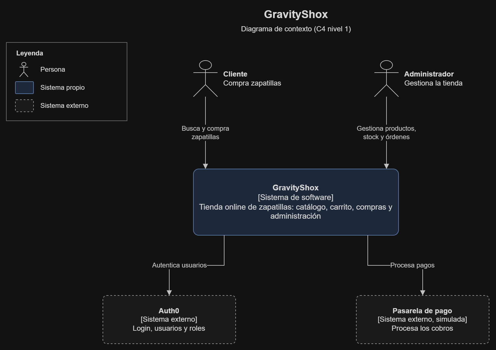
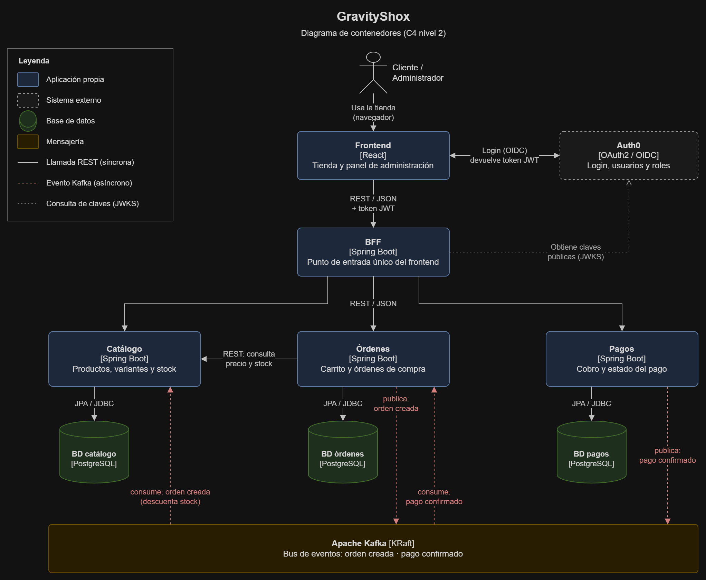
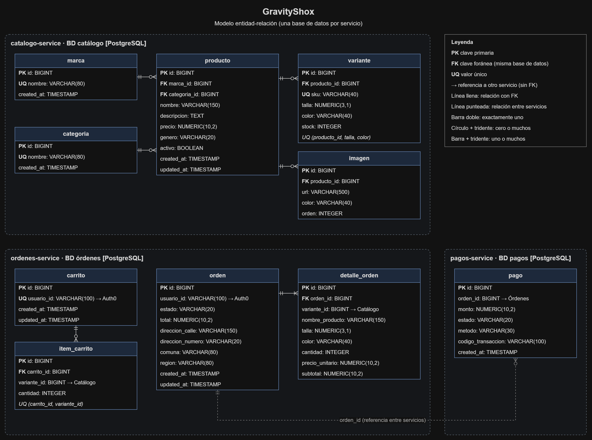
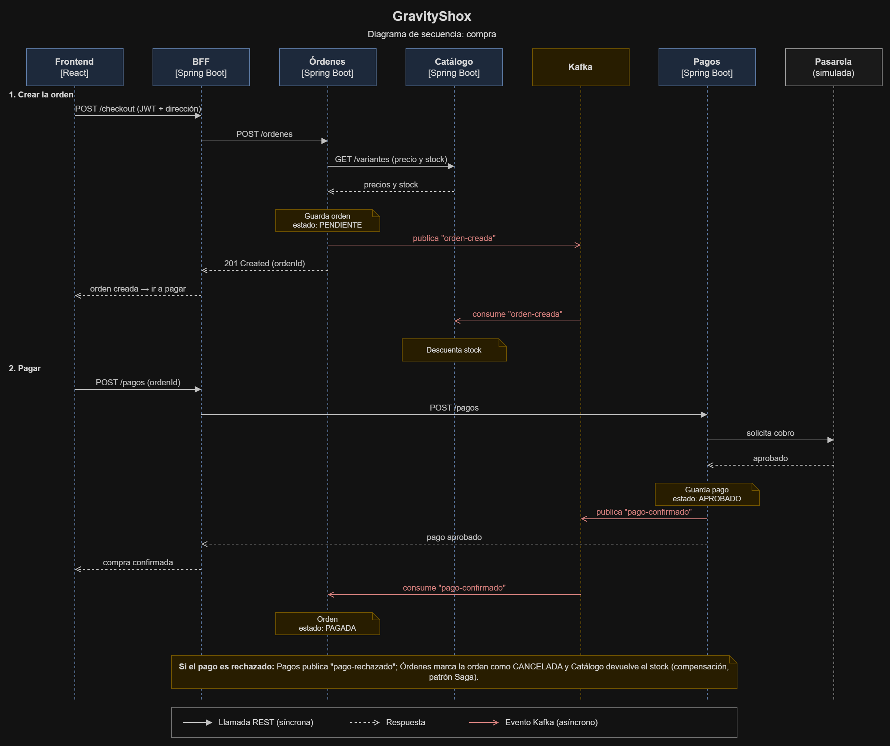

# GravityShox

Tienda online de zapatillas construida con arquitectura de microservicios.

## Arquitectura

### Contexto

### Contenedores

### Modelo de datos
Cada microservicio tiene su propia base de datos. Entre servicios no hay claves foráneas: se referencian por id.

### Flujo de compra

## Stack tecnológico

| Capa | Tecnologías |
|---|---|
| Backend | Java 21, Spring Boot, Spring Data JPA, HikariCP, MapStruct |
| Comunicación | REST, Apache Kafka (modo KRaft) |
| Resiliencia | Resilience4j (Circuit Breaker) |
| Seguridad | Auth0 (OAuth2 / OpenID Connect), JWT |
| Base de datos | PostgreSQL, Flyway |
| Frontend | React |
| Pruebas | JUnit 5, Mockito |
| Documentación | Springdoc OpenAPI (Swagger) |
| Infraestructura | Docker, Docker Compose, pgAdmin, Kafdrop |

## Estructura del repositorio

    gravityshox/
    ├── catalogo-service/   # Productos, variantes y stock
    ├── ordenes-service/    # Carrito y órdenes
    ├── pagos-service/      # Pagos
    ├── bff/                # Backend For Frontend
    ├── frontend/           # React
    ├── infra/              # Scripts de infraestructura
    └── docs/               # Diagramas y documentación

## Autor

Braulio — [GitHub](https://github.com/metamistyk)